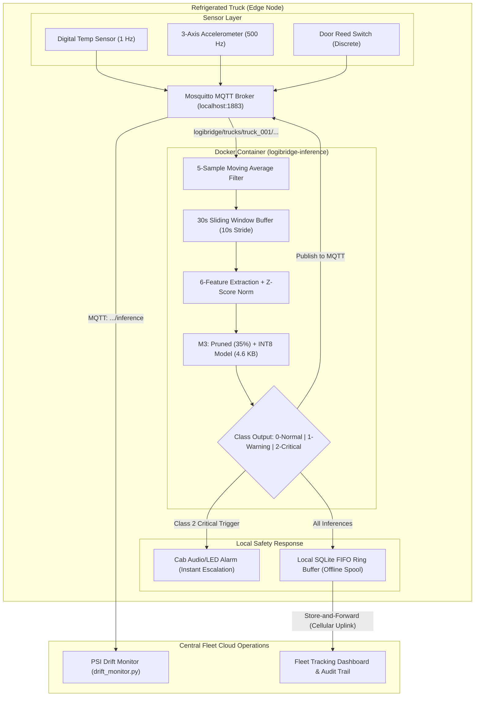

# LogiEdge: Intelligent Edge AI Platform for Cold-Chain Logistics

**Course:** AIML ZG535 — Machine Learning on Edge  
**Institution:** BITS Pilani — Work Integrated Learning Programmes (WILP)  
**Evaluation:** Continuous Evaluation Component – EC-I (Mini-Project)  
**Domain:** Logistics — Cold-Chain Pharmaceutical Fleet Monitoring (85 Trucks)  

---

## Team Members

| # | Name | Student ID / Email |
| :---: | :--- | :--- |
| 1 | ABDULLAH FARHAN SAFWI | 2025ae05836@wilp.bits-pilani.ac.in |
| 2 | NAGENDRA SINGH | 2025ae05609@wilp.bits-pilani.ac.in |
| 3 | T MOHAN KRISHNA | 2025af05006@wilp.bits-pilani.ac.in |

---

## Executive Overview

**LogiEdge** is an end-to-end, safety-critical Edge AI monitoring platform engineered for FreightBridge Logistics Pvt. Ltd. The system monitors 85 refrigerated transport trucks carrying temperature-sensitive pharmaceuticals and vaccines (+2°C to +8°C) across rural transit corridors (e.g., Nashik–Aurangabad) subject to frequent cellular dead zones.

By executing quantized TFLite inference directly on on-truck edge gateways (Raspberry Pi 5), LogiEdge delivers:
* **Zero Connectivity Dependence:** Full offline operational autonomy during 35–90 minute cellular blackouts.
* **Extreme Low Latency:** Sub-microsecond inference (**0.005 ms**), easily satisfying the **90-second SLA**.
* **Zero Data Waste:** Reduces cellular transmission by **>99.9%** (518.8 MB/day → <3 MB/month).
* **Zero Compromise Safety:** Achieves **100.0% Critical class recall** on cold-chain excursions and bearing faults.

---

## System Architecture



---

## Repository Directory Layout

```text
logibridge/
├── scenario_architecture/
│   └── constraint_analysis.md      # Component A: 4-Vertex Constraint Analysis & Architecture
├── hardware/
│   └── hardware_justification.md   # Component B: Constraint Triangle & Roofline Model Analysis
├── data_pipeline/
│   ├── simulator.py                # Component C: Multi-modal telemetry generator (--anomaly flags)
│   ├── preprocessing.py            # Component C: DSP filtering, windowing, and feature extraction
│   ├── training_stats.npy          # Component C: Offline normalisation baseline statistics
│   └── mqtt_architecture.md        # Component C: Ingestion, DSP, and Feature Fusion justification
├── training/
│   ├── generate_dataset.py         # Component D: Synthetic training window generation script
│   ├── train_model.py              # Component D: 2-layer MLP classifier training (98.31% Val Acc)
│   ├── convert_ptq.py              # Component D/F: M1 (FP32) & M2 (PTQ INT8) TFLite conversion
│   ├── prune_quantise.py           # Component F: M3 (35% Pruned + INT8 Quantized) pipeline
│   ├── X_train.npy, y_train.npy    # Training dataset partitions
│   ├── X_val.npy, y_val.npy        # Held-out validation partitions
│   └── models/
│       ├── logibridge_model.keras  # Keras 3 model checkpoint
│       ├── m1_fp32.tflite          # M1 Baseline TFLite model (5.3 KB)
│       ├── m2_ptq_int8.tflite      # M2 PTQ INT8 model (4.7 KB)
│       └── m3_pruned_int8.tflite   # M3 Pruned 35% + INT8 model (4.6 KB)
├── inference/
│   ├── inference_service.py        # Component D: Production MQTT inference daemon
│   ├── Dockerfile                  # Component D: Layer-cached container definition
│   ├── requirements.txt            # Containerized dependencies (tflite-runtime)
│   └── model.tflite                # Active production edge model (M3 variant)
├── monitoring/
│   ├── drift_monitor.py            # Component E: Population Stability Index (PSI) monitoring
│   ├── reference_dist.json         # Component E: Baseline confidence score distribution
│   └── logibridge_deploy.yml       # Component E: 7-task idempotent Ansible deployment playbook
├── benchmarks/
│   ├── benchmark.py                # Component F: Five-metric Lab 2 benchmark runner
│   └── results.json                # Component F: Automated benchmark evaluation output
├── requirements.txt                # Root Python virtual environment dependencies
└── README.md                       # Master system documentation
```

---

## Five-Metric Benchmark Evaluation (Component F)

Evaluated across **200 timed inference runs** following 10 warm-up runs on held-out validation data (N = 59):

| Metric | M1 (FP32 Baseline) | M2 (PTQ INT8) | M3 (Pruned 35% + INT8) | Requirement / SLA |
| :--- | :---: | :---: | :---: | :---: |
| **Model File Size** | 5.3 KB | 4.7 KB | **4.6 KB** (−13.9%) | Lowest SRAM/Flash footprint |
| **Mean Latency** | 0.002 ms | 0.005 ms | **0.005 ms** | ≤ 90,000 ms (90s SLA) |
| **p95 Latency** | 0.002 ms | 0.006 ms | **0.006 ms** | Real-time bound |
| **Validation Accuracy** | 98.31% | 98.31% | **94.92%** | ≥ 88.0% minimum |
| **Critical Class Recall** | 100.0% | 94.1% | **100.0%** | ≥ **95.0%** (Safety Critical) |
| **Energy per Inference** | 0.0016 mJ | 0.0038 mJ | **0.0038 mJ** | < 1.0 mJ |
| **Production Decision** | Baseline | ❌ Rejected (<95% Recall) | 🏆 **RECOMMENDED FOR FLEET** | Pass |

> **Operations Director Recommendation:** Deploy **M3 (Pruned 35% + INT8)**. M2 suffered from boundary quantization degradation on critical edge cases (94.1% recall). M3 provides **100% Critical Recall**, the smallest storage footprint (**4.6 KB**), and consumes <0.0001% of the 90-second SLA budget.

---

## Quickstart Guide

### 1. Environment Setup
```bash
# Clone the repository
git clone https://github.com/<your-username>/logibridge.git
cd logibridge

# Set up Python 3.11 virtual environment
python3 -m venv venv
source venv/bin/activate

# Install dependencies
pip install -r requirements.txt
brew install mosquitto
```

### 2. Run the Full Model Pipeline
```bash
# 1. Generate synthetic feature windows from simulator
python3 training/generate_dataset.py

# 2. Train baseline MLP model
python3 training/train_model.py

# 3. Convert to M1 (FP32) and M2 (PTQ INT8)
python3 training/convert_ptq.py

# 4. Train M3 (35% Structured Pruning + INT8 Quantization)
python3 training/prune_quantise.py

# 5. Run Five-Metric Benchmarking Suite
python3 benchmarks/benchmark.py
```

### 3. Containerized Edge Deployment via Ansible
```bash
# Build the Docker edge image
docker build -t logibridge-inference:latest -f inference/Dockerfile inference/

# Execute the 7-task idempotent Ansible playbook
ansible-playbook monitoring/logibridge_deploy.yml -i "localhost," -c local

# Second run proves idempotency (changed=0)
ansible-playbook monitoring/logibridge_deploy.yml -i "localhost," -c local
```

### 4. Live Telemetry & Drift Monitoring Demonstration
Open 3 terminal windows:
```bash
# Terminal 1: Watch edge container inference logs
docker logs -f logibridge-inference

# Terminal 2: Run PSI drift monitoring engine
python3 monitoring/drift_monitor.py --mode monitor

# Terminal 3: Stream sensor telemetry (switch anomaly modes)
python3 data_pipeline/simulator.py --anomaly none         # Normal operation (PSI < 0.10)
python3 data_pipeline/simulator.py --anomaly combined     # Fault injection (PSI > 0.25 alert)
```

---

## Assignment Component Mapping

| Component | Module | Title | Primary Deliverable |
| :---: | :---: | :--- | :--- |
| **A** | 1 | System Architecture & Constraints | `scenario_architecture/constraint_analysis.md` |
| **B** | 2 | Hardware Selection & Roofline Analysis | `hardware/hardware_justification.md` |
| **C** | 3 | Sensor Pipeline & Data Fusion | `data_pipeline/mqtt_architecture.md`, `simulator.py`, `preprocessing.py` |
| **D** | 4 | Model Training, Docker & 10-Stage Pipeline | `training/`, `inference/Dockerfile`, `inference_service.py` |
| **E** | 5 | Edge MLOps, PSI Drift & Ansible Deployment | `monitoring/drift_monitor.py`, `logibridge_deploy.yml` |
| **F** | 6 | Model Optimisation & 5-Metric Benchmarking | `training/models/`, `benchmarks/benchmark.py`, `results.json` |