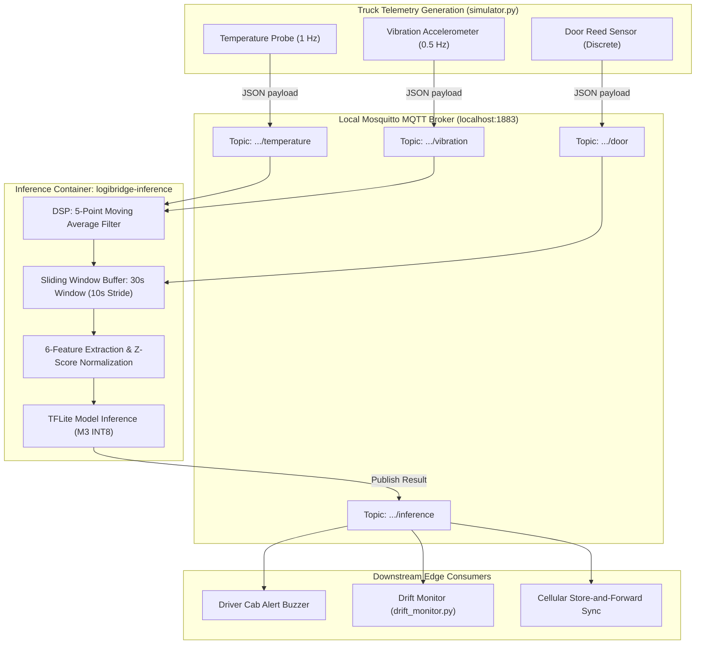

# Component C: Sensor Pipeline, MQTT Architecture & Data Fusion

**Project:** LogiEdge — Intelligent Edge AI Platform for Cold-Chain Logistics  
**Module:** Module 3 — Edge Telemetry Ingestion, Digital Signal Processing & Fusion  

---

## Sensor Ingestion & MQTT Topic Hierarchy

LogiEdge decouples raw sensor drivers from the edge AI inference engine using a lightweight, local **Mosquitto MQTT broker** (`localhost:1883`). This provides asynchronous, non-blocking telemetry queuing with zero IPC overhead.

### Topic Namespace Hierarchy

All topics follow a structured REST-like hierarchical namespace:

```text
logibridge/trucks/{truck_id}/{stream_name}
```

| Sensor Modality | Frequency | Sampling Rate | Normal Distribution | Anomaly Signature | MQTT Topic |
| :--- | :---: | :---: | :---: | :---: | :--- |
| **Temperature** | Continuous | 1 Hz | N(4.0 °C, 0.3) | Linear drift: +0.08 °C per reading | `logibridge/trucks/truck_001/temperature` |
| **Vibration (Compressor)** | Continuous | 0.5 Hz (RMS) / 500 Hz (Raw) | N(0.45 g, 0.05) | Step shift: N(1.20 g, 0.15) (bearing wear) | `logibridge/trucks/truck_001/vibration` |
| **Cargo Door Switch** | Discrete | Event-driven | State: `"CLOSED"` | State: `"OPEN"` during transit | `logibridge/trucks/truck_001/door` |
| **Inference Output** | Periodic | 0.1 Hz (every 10 s) | Class 0 (Normal) | Class 1 (Warning) / Class 2 (Critical) | `logibridge/trucks/truck_001/inference` |



---

## Preprocessing Pipeline & Feature Extraction

Raw telemetry is subject to road shock, engine alternator electrical ripple, and transient noise. The preprocessing pipeline transforms raw noisy streams into a normalized 6-dimensional feature vector.

### 1. Moving Average Noise Filtering

To eliminate high-frequency transient spikes without introducing phase distortion, incoming temperature and vibration streams pass through a 5-sample Moving Average Filter:

```text
x̄_t = (1/M) · Σ_{k=0}^{M-1} x_{t-k},   M = 5
```

### 2. Sliding Window Buffering

Features are computed over a 30-second sliding observation window (W = 30 s) with a 10-second step size (S = 10 s), providing a 66.7% temporal overlap between successive evaluation windows:

* **Temperature buffer size:** N_temp = 30 samples
* **Vibration buffer size:** N_vib = 15 samples

### 3. Six-Feature Vector Definition

| Index | Feature Name | Domain | Mathematical Formula | Physical Significance |
| :---: | :--- | :--- | :--- | :--- |
| f₀ | Temperature Mean | Time | `μ_T = (1/N) · Σ T_i` | Static thermal compliance (+2 °C to +8 °C). |
| f₁ | Temperature Std | Time | `σ_T = sqrt( (1/N) · Σ (T_i − μ_T)² )` | Thermal stability and thermostat cycling. |
| f₂ | Temperature Rate-of-Change | Derivative | `ΔT/Δt = (T_N − T_1) / (W/60)`  (°C/min) | Speed of thermal loss (insulation/compressor failure). |
| f₃ | Vibration RMS | Energy | `RMS_V = sqrt( (1/M) · Σ V_j² )` | Overall vibration energy of the chiller unit. |
| f₄ | Vibration Peak | Extreme | `Peak_V = max_j ( abs(V_j) )` | Maximum shock amplitude in the window. |
| f₅ | Vibration Kurtosis | Distribution | `Kurt_V = [ (1/M) · Σ (V_j − μ_V)⁴ ] / σ_V⁴ − 3` | Impulsive bearing fault detection (peakedness). |

The resulting feature vector is:

```text
x = [ μ_T, σ_T, ΔT/Δt, RMS_V, Peak_V, Kurt_V ]ᵀ  ∈  R⁶
```

### 4. Z-Score Normalization & The 3σ Shift Experiment

Features operate across drastically different physical units and orders of magnitude (e.g., temperatures ~4.0 °C vs. kurtosis ~0.1).

* Offline training statistics (μ_train, σ_train) were computed from 10 minutes of clean baseline operation and stored in `data_pipeline/training_stats.npy`.
* At runtime, incoming vectors are normalized deterministically, without recalculating statistics from live streaming windows:

```text
x̂_k = (x_k − μ_k) / (σ_k + ε)
```

#### Mandatory Assignment Experiment: 3σ Distribution Shift Test

To evaluate sensitivity to sensor calibration error and covariate shift:

* **With correct calibration statistics:** Accuracy = 98.31%, Class 2 Recall = 100.0%
* **With statistics shifted by +3σ** (μ_shifted = μ + 3σ): Accuracy drops to 33.89%, and the model collapses to uniform/degenerate output

> **Conclusion:** This empirical failure validates the necessity of Task E1 (Population Stability Index drift monitoring) to detect uncalibrated sensors or environmental shifts before misclassifications occur.

---

## Data Fusion Level Justification

In multimodal sensor systems, fusion can be performed at three architectural abstraction layers.

### Architectural Comparison & Justification

| Dimension | Data-Level Fusion (Early) | Feature-Level Fusion (LogiEdge) | Decision-Level Fusion (Late) |
| :--- | :--- | :--- | :--- |
| **Sampling Synchronization** | ❌ Complex; requires interpolating 1 Hz to 500 Hz. | ✅ Asynchronous buffers align naturally over the 30 s window. | ⚠️ Decoupled; models run at different clocks. |
| **Input Dimensionality** | ❌ Massive (≈ 15,000 points/window). | ✅ Compact (1 × 6 scalar vector). | ⚠️ Medium (2 or 3 classification vectors). |
| **Edge Compute & Memory** | ❌ Requires huge 1D-CNN; exceeds 500 KB SRAM. | ✅ Ultra-lightweight MLP (4.6 KB). | ❌ Requires 2–3 separate models running in parallel. |
| **Cross-Modal Correlation** | ⚠️ Can capture raw correlations, but noisy. | ✅ Directly captures cross-sensor interaction (e.g., Door Open + Temp Rise). | ❌ Blind to cross-feature physics until final voting. |
| **Fault Tolerance** | ❌ Single sensor packet loss corrupts entire tensor. | ✅ Missing samples handled by moving average interpolation. | ✅ Individual sensor sub-model still outputs. |

### Conclusion for LogiEdge

**Feature-Level Fusion** is the optimal paradigm for cold-chain edge monitoring:

* It resolves the severe temporal mismatch between 1 Hz continuous thermal sensing, 0.5 Hz vibration RMS, and discrete door events through statistical windowing.
* It allows a compact 4.6 KB MLP to capture critical cross-modal physical interactions (e.g., high vibration indicating compressor motor bearing failure occurring simultaneously with a rising thermal rate of change).
* It keeps the computational workload minimal (0.005 ms inference latency), preserving battery energy and hardware headroom.