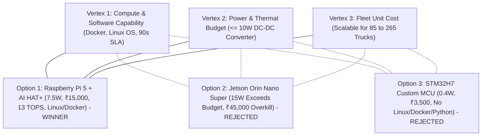
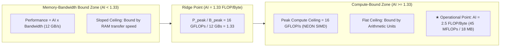

# Component B: Hardware Selection & Roofline Performance Analysis

**Project:** LogiEdge — Intelligent Edge AI Platform for Cold-Chain Logistics  
**Deployment Fleet:** 85 Pilot Trucks (expandable to 265 Commercial Fleet)  

---

## The Edge AI Constraint Triangle Application

Edge hardware selection balances three conflicting vertices in the **Constraint Triangle**:
1. **Compute & Software Capability** (Meeting the 90s SLA, handling 500 Hz vibration DSP, running Docker/MQTT/Ansible)
2. **Power & Thermal Budget** (≤ 10 W available from 12V automotive auxiliary battery via DC-DC converter)
3. **Fleet Economics / Unit Cost** (Scalable across 85 pilot trucks → 265 production fleet)



### Comparative Evaluation Matrix

| Criterion | Option 1: Raspberry Pi 5 + AI HAT+ | Option 2: Jetson Orin Nano Super | Option 3: STM32H7 Custom MCU |
| :--- | :--- | :--- | :--- |
| **Compute / NPU** | Quad-core Cortex-A76 @ 2.4 GHz + 13 TOPS (Hailo-8L) | 6-core Cortex-A78AE + Ampere GPU (67 TOPS) | 480 MHz Arm Cortex-M7 (No NPU) |
| **Memory / Storage** | 8 GB LPDDR4X + 64 GB MicroSD/NVMe | 8 GB LPDDR5 + NVMe SSD | 1 MB SRAM + 2 MB Internal Flash |
| **Power Consumption** | **7.5 W** (within budget) | **15 W** (exceeds budget) | **0.4 W** (ultra-low) |
| **India Unit Cost** | **~₹15,000 / truck** | **~₹45,000 / truck** | **~₹3,500 / truck** |
| **Pilot Fleet (85)** | ₹12,75,000 | ₹38,25,000 | ₹2,97,500 |
| **Full Fleet (265)** | ₹39,75,000 | ₹1,19,25,000 | ₹9,27,500 |
| **OS / Runtime** | Debian Linux 64-bit, Docker, Python 3.11 | Ubuntu Linux 64-bit, Docker, JetPack | Bare-Metal / FreeRTOS, C/C++ |
| **90s SLA Feasibility**| ✅ Yes (0.005 ms inference) | ✅ Yes (<0.001 ms inference) | ✅ Yes (~1.5 ms inference) |

---

### Dominant Constraint & Architectural Argument

**Dominant Constraint Vertex:** **Power/Thermal Budget (≤ 10 W) combined with Software Stack Programmability (Containerized OTA updates).**

#### Why Option 1 (Raspberry Pi 5 + AI HAT+) is the Winning Choice:
1. **Power Compliance:** Under full load, the Pi 5 draws approximately **7.5 W**, fitting safely inside the **10 W limit** delivered by an isolated 12V-to-5V DC-DC automotive buck converter. It operates reliably even when the truck engine is idling or switched off during delivery handoffs without draining the battery.
2. **Software & Container Ecosystem:** The assignment mandates containerized deployments (Docker), remote automated updates (Ansible), and local MQTT message brokering. Raspberry Pi OS natively supports the entire production stack (Docker Engine, Python 3.11, Mosquitto, SQLite spooling).
3. **Fleet Economics:** At ₹15,000/truck, equipping 85 trucks costs ₹12.75 Lakhs (compared to ₹38.25 Lakhs for Option 2). This provides an optimal capital expenditure (CapEx) profile while reserving 13 TOPS of NPU acceleration for future visual cargo-inspection cameras.

#### Rejection of Option 2 (NVIDIA Jetson Orin Nano Super):
* **Violates Power Budget:** Consuming **15 W** under moderate load, it exceeds the 10 W auxiliary power ceiling. In an unventilated truck cabin under 45°C ambient Indian summer temperatures, it requires forced active fan cooling and risks thermal throttling or battery depletion.
* **Prohibitive Cost & Overkill:** At ₹45,000 per truck, deploying to 265 trucks costs **₹1.19 Crores**. Providing 67 TOPS for a lightweight 45 MFLOPs MLP classifier is an egregious over-provisioning of resources.

#### Rejection of Option 3 (STM32H7 Custom MCU):
* **Incompatible Software Architecture:** With only 1 MB of SRAM and no MMU (Memory Management Unit), it **cannot run Linux, Docker containers, or Python**. This prevents containerized OTA updates (Task D2) and automated Ansible fleet provisioning (Task E2).
* **High Non-Recurring Engineering (NRE) Cost:** Designing, fabricating, and certifying custom automotive-grade PCBs with CAN/I2C breakout, cellular modem, and thermal protection introduces substantial hardware development timelines and risks that outweigh its unit cost advantage.

---

## Arithmetic Intensity & Roofline Model Analysis

The Roofline model bounds algorithm execution time based on peak processor compute throughput and peak memory bandwidth.

### Model & Hardware Operational Parameters
* **Model Work per Inference (W):** 45 MFLOPs = 45 × 10⁶ FLOPs
* **Memory Traffic per Inference (Q):** 18 MB = 18 × 10⁶ Bytes (Weights + Activation memory reads/writes)
* **Processor Peak Compute Throughput (P_peak):** 16 GFLOP/s = 16 × 10⁹ FLOP/s (Raspberry Pi 5 Cortex-A76 NEON SIMD)
* **Processor Peak Memory Bandwidth (B_peak):** 12 GB/s = 12 × 10⁹ Bytes/s (LPDDR4X-4267)

---

### Step 1: Calculate Arithmetic Intensity (AI)
Arithmetic Intensity is the ratio of operational work (FLOPs) to memory traffic (Bytes):

```text
AI = W / Q = (45 × 10⁶ FLOPs) / (18 × 10⁶ Bytes) = 2.5 FLOP/Byte
```

**AI = 2.5 FLOP/Byte**

---

### Step 2: Calculate Hardware Ridge Point (AI_ridge)
The ridge point represents the minimum Arithmetic Intensity required to achieve peak theoretical compute throughput:

```text
AI_ridge = P_peak / B_peak = (16 × 10⁹ FLOP/s) / (12 × 10⁹ Bytes/s) = 16 / 12 ≈ 1.33 FLOP/Byte
```

**AI_ridge ≈ 1.33 FLOP/Byte**

---

### Step 3: Classification (Memory-Bound vs. Compute-Bound)
We compare the model's Arithmetic Intensity (AI) to the processor's Ridge Point (AI_ridge):

```text
AI (2.5 FLOP/Byte) > AI_ridge (1.33 FLOP/Byte)
```

* **Classification: COMPUTE-BOUND**
* **Justification:** The operational point lies to the **right of the ridge point** on the flat horizontal ceiling of the Roofline curve. The processor executes 2.5 mathematical operations for every byte transferred across the memory bus. Therefore, execution latency is constrained by the CPU's arithmetic pipelines, not memory transfer bandwidth.



---

### Step 4: Optimization Strategy Based on Roofline Analysis

Because the operational point is **compute-bound**:
1. **Ineffective Optimizations:** Increasing memory bus frequency, memory interleaving, or pre-fetching will yield **negligible performance improvements**, because the memory bus is idle while arithmetic units compute.
2. **Effective Optimizations to Reduce Latency:**
   * **Reduce Operational Count (W) via Structured Pruning:** Removing 35% of redundant weights/filters directly reduces the required arithmetic operations from 45 MFLOPs to ~29 MFLOPs.
   * **Increase Operational Throughput via INT8 SIMD Vectorization:** Switching from FP32 to INT8 allows ARM NEON vector instructions (`sdot` / `udot`) to process **four 8-bit integer multiply-accumulates per cycle per pipeline**, quadrupling peak operational throughput (P_peak) from 16 GFLOP/s to 64 GOPS.
   * **NPU Hardware Offload:** Offloading the matrix multiplications to the Hailo-8L NPU (13 TOPS) provides roughly 200× headroom over the host CPU (13 TOPS vs. 64 GOPS INT8).