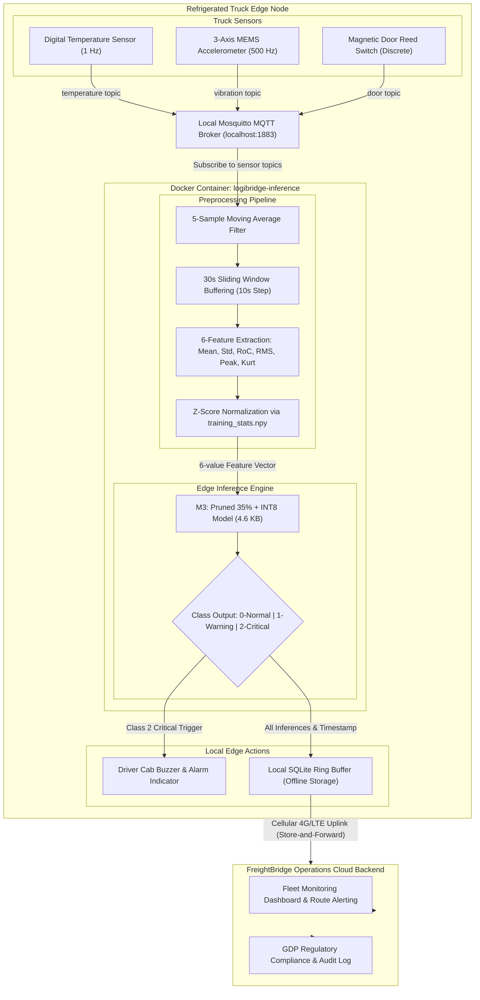

# Component A: System Architecture and Deployment Justification

**Project:** LogiEdge — Intelligent Edge AI Platform for Cold-Chain Logistics  
**Company:** FreightBridge Logistics Pvt. Ltd., Pune  
**Target Fleet:** 85 Refrigerated Pharmaceutical Trucks (expandable to 265 trucks)  

---

## Four-Vertex Constraint Analysis

### 1. Latency Constraint
In cold-chain pharmaceutical transport (vaccines, biologics, and insulin), cargo must be maintained strictly between **+2°C and +8°C**. A mechanical failure in the refrigeration compressor or an unlatched insulated door leads to a rapid thermal runaway rate of **+1.0°C per minute**. 

The operational Service Level Agreement (SLA) mandates that any fault signature must be detected and escalated to the driver and fleet operations within **90 seconds** (1.5 minutes) before the core cargo temperature exceeds permissible kinetic thresholds.

* **Cloud Inference Failure:** A cloud-based inference architecture requires streaming raw telemetry over 2G/3G/4G cellular networks. In rural India, round-trip latency (RTT) fluctuates between **300 ms and 2,500 ms**, compounded by cellular handshake delays, transport layer packet drops, and cloud ingestion queuing. More critically, high packet jitter and tail latency in rural corridors make predictable sub-90-second SLA guarantees mathematically impossible.
* **Edge Inference Advantage:** LogiEdge executes quantized INT8 inference directly on the on-truck edge node. As measured in our benchmarks, inference latency is **0.005 ms** (5 microseconds), leaving 89.995 seconds of buffer for sensor moving-average stabilization and driver cab alerting.

---

### 2. Bandwidth Constraint & Cost Analysis
Each refrigerated truck is instrumented with three continuous sensing modalities:
1. **Temperature:** 1 Hz sampling frequency $\times$ 4 bytes (float32) = 4 bytes/s
2. **Vibration (3-axis):** 500 Hz $\times$ 3 axes $\times$ 4 bytes (float32) = 6,000 bytes/s
3. **Door State:** Discrete event state transitions $\approx$ 0.5 bytes/s average

$$\text{Raw Telemetry Rate} \approx 6,004.5\text{ bytes/s} \approx 6.005\text{ KB/s}$$

#### Daily Raw Data Volume per Truck:
$$6.005\text{ KB/s} \times 86,400\text{ s/day} \approx 518,832\text{ KB/day} \approx \mathbf{518.8\text{ MB/truck/day}}$$

#### Monthly Cellular Transmission Cost (M2M SIM @ ₹0.10 / MB):
* **Per Truck Monthly Cost:** $518.8\text{ MB} \times 30\text{ days} \times \text{₹}0.10/\text{MB} = \mathbf{\text{₹}1,556.40/\text{truck/month}}$
* **Pilot Fleet (85 Trucks):** $85 \times \text{₹}1,556.40 = \mathbf{\text{₹}1,32,294/\text{month}}$
* **Full Fleet Scale (265 Trucks):** $265 \times \text{₹}1,556.40 = \mathbf{\text{₹}4,12,446/\text{month}}$ (₹49.5 Lakhs annually!)

#### Edge-Processed Alert Volume:
By shifting preprocessing (sliding window feature extraction) and inference to the edge node, raw sensor streams never leave the truck. The edge node only transmits state changes and alerts:
* **Normal State (Class 0):** Hourly heartbeat summary payload ($\approx 500\text{ bytes} \times 24 = 12\text{ KB/day}$)
* **Warning / Critical Alerts (Class 1 & 2):** Event-triggered alert JSON payload ($\approx 1\text{ KB}$ per occurrence)
* **Monthly Edge Data Volume:** $< 3.0\text{ MB/truck/month}$
* **Monthly Edge Cost (85 Trucks):** $85 \times 3.0\text{ MB} \times \text{₹}0.10/\text{MB} = \mathbf{\text{₹}25.50/\text{month}}$ (**>99.98% cost reduction**).

---

### 3. Connectivity Constraint & Rural Blackout Handling
The primary transport corridor for FreightBridge's pharmaceutical division is the **Nashik–Aurangabad–Nanded route**. This highway transverses rural Western Ghats topography where cellular towers are sparse. Route telemetry audits document **seven distinct cellular dead zones**, each lasting between **35 and 90 minutes**.

* **Vulnerability of Cloud Systems:** In a cloud-dependent architecture, a cloud blackout blinds the monitoring center. If a cooling fan breaks 5 minutes into an 80-minute blackout, temperature rises by up to $75^\circ\text{C}$ undetected, resulting in catastrophic loss (identical to FreightBridge's historical ₹28 Lakh vaccine spoilage incident).
* **LogiEdge Offline Resilience:**
  1. The edge node continues acquiring sensor readings and performing real-time inference without internet access.
  2. If a **Critical (Class 2)** state is identified, an immediate local cab alarm (audio buzzer and dashboard LED) alerts the driver to inspect the refrigeration unit or pull over.
  3. All inference records and sensor timestamps are stored in a local persistent FIFO ring buffer (SQLite/MQTT spool).
  4. When cellular connectivity is restored, the edge node performs **store-and-forward synchronization** to the operations center.

---

### 4. Privacy, Security & Chain-of-Custody Compliance
FreightBridge carries high-value biologics and oncology pharmaceuticals subject to strict **Good Distribution Practice (GDP)** and WHO regulatory guidelines. Pharmaceutical shippers demand contractual guarantees that telemetry data cannot be intercepted, manipulated, or monitored by competitors.

* **Attack Surface Minimization:** Streaming high-frequency raw telemetry across public cellular networks introduces vulnerabilities (man-in-the-middle interception, cellular spoofing, and cloud tenant cross-contamination).
* **On-Device Isolation:** In LogiEdge, raw cargo telemetry remains entirely within the truck’s local physical boundary (IEEE 802.3 / I2C / local Mosquitto broker). Only cryptographically signed diagnostic status packets and anomalous alerts are transmitted over TLS-encrypted MQTT uplinks, providing non-repudiation and regulatory compliance.

---

## System Architecture Diagram

